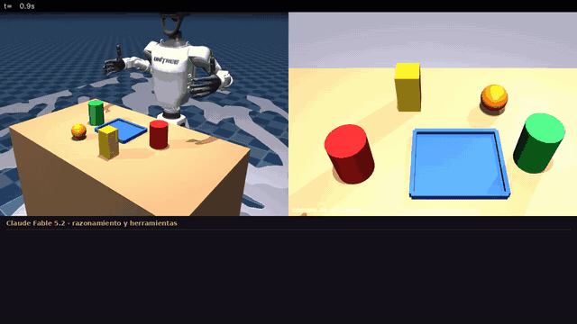

# humanoidHarness — Claude Fable 5.2 maneja un Unitree G1 con manos BrainCo Revo2

Arnés para que un LLM (Claude Fable 5.2) haga pick-and-place con un humanoide Unitree G1 Edu U7 y manos
BrainCo Revo2 de 5 dedos. Funciona en simulación (MuJoCo). **El despliegue en el G1 real está en progreso (WIP)**;
ver [Robot real](#robot-real-wip).



Instrucción: *"Recoge la mesa: guarda en la charola azul solo los objetos cilíndricos, usando una mano para cada
uno. Lo que no sea cilindro se queda donde está."* Fable distingue los cilindros de la caja y la pelota, elige el
agarre de lado, toma uno con cada mano y los deja en la charola. Fueron 3 llamadas a la API y ~$0.10.
El panel de abajo muestra el resumen de su razonamiento, lo que dice y cada herramienta con su resultado.
Video completo: [`docs/media/demo_recoger_mesa.mp4`](docs/media/demo_recoger_mesa.mp4) (a velocidad real, 84 s).

Fable 5.2 (`claude-fable-5-2`) ve la cámara de la cabeza y decide **qué** tomar y **dónde** dejarlo,
señalando píxeles. El código local decide **cómo** moverse:

```
Fable 5.2 ──herramientas──► look · inspect_point · pick(x,y,mano,objeto,agarre) · place(x,y,mano) · home
                                │
   píxel → máscara SAM2 + depth D435i → objeto 3D (centro, radio, alto; marco pelvis)
   → plan IK completo (pinocchio, por brazo; agarre "arriba" o "lado")
   → trayectoria articular lenta → rt/lowcmd (modo debug) + rt/brainco/*/cmd (Revo2 de 5 dedos)
```

Cada plan se resuelve completo (todos los puntos de IK) antes de mover el brazo. En el robot real,
cada `pick`, `place` y `home` espera tu Enter.

Dentro de `pick`, siguiendo a HomeBody (Stanford TML):
- **Segmentación.** Con el servidor de SAM2, el objeto se segmenta desde el clic de Fable.
- **Segunda mirada.** Antes de bajar vuelve a mirar desde arriba. Si el objeto se movió menos de 4 cm corrige el agarre; si se movió más, aborta.
- **Verificación.** Al levantar revisa que los dedos hicieron contacto y que el lugar del objeto en la mesa quedó vacío. Si falló, abre la mano y se lo dice a Fable.

| archivo | qué hace |
|---|---|
| `agent.py` | ciclo con Fable 5.2: streaming, herramientas `strict`, historial que solo crece, caching, fallback por rechazo, registro en `runs/` |
| `skills.py` | percepción (píxel→3D, máscara SAM2, superficie de apoyo), planes de agarre (arriba/lado) y soltar, ejecución |
| `segment.py` | servidor SAM2 2.1 tiny por ZMQ (GPU en la laptop, CPU en la Jetson) y su cliente |
| `kinematics.py` | IK por brazo (codo hacia afuera), pose de la cámara (`d435_joint` del URDF), TCP de la mano, gravedad |
| `hand_model.py` | BrainCo Revo2 de 5 dedos desde sus URDF/mallas: montaje en la muñeca, 6 comandos → 11 articulaciones, centro del agarre, puntos de su superficie |
| `g1_model.py` | G1 con las Revo2 en lugar de las Dex3, para la simulación y el detector de choques |
| `collision.py` | autocolisión de cada trayectoria planeada (envolventes de las mallas en MuJoCo) |
| `robot_sim.py` | G1 colgado en MuJoCo con mesa, charola y escenas (`recoger_mesa`, `lata_vaso`, `lata_caja`, `cilindro_azul`); graba MP4 con el panel de razonamiento |
| `robot_real.py` | controlador propio en modo debug + BrainCo + cliente de cámara |
| `cam_server.py` | corre en la Jetson: color + depth alineado + intrínsecos por ZMQ |
| `check_real.py` | puesta en marcha paso a paso: cámara, ArUco, mano, brazo |
| `aruco.py` | detección de ArUco/AprilTag (diccionario automático), pose 3D por profundidad y por PnP |
| `calib.py` | calibración de la cámara de la cabeza con un ArUco en el dorso de la mano (convención de HomeBody) |
| `hh.sh`, `start_cam.sh`, `stop_cam.sh`, `start_seg.sh` | arranque en la Jetson del G1 |
| `selftest_sim.py` | prueba sin API: un oráculo señala los objetos y usa las mismas herramientas |

## Instalación

Python 3.10, dependencias en [`requirements.txt`](requirements.txt). Para el robot real también hace falta
[`unitree_sdk2py`](https://github.com/unitreerobotics/unitree_sdk2_python).

Los modelos del G1 y de la Revo2 **no vienen en este repo**: se toman de un checkout de
[`xr_teleoperate`](https://github.com/unitreerobotics/xr_teleoperate) (carpeta `assets/`). Por defecto se buscan en
`~/xr_teleoperate/assets`; para otra ruta usa estas variables:

| variable | por defecto |
|---|---|
| `FABLE_PICK_URDF` | `~/xr_teleoperate/assets/g1/g1_body29_hand14.urdf` |
| `FABLE_PICK_MJCF` | `~/xr_teleoperate/assets/g1/g1_body29_hand14.xml` |
| `FABLE_PICK_BRAINCO` | `~/xr_teleoperate/assets/brainco_hand` |

Credenciales de la API: `ant auth login` (CLI de Anthropic) o `export ANTHROPIC_API_KEY=...` (de
[platform.claude.com](https://platform.claude.com/settings/keys)).

En la laptop del laboratorio el entorno es un venv encima del env conda `tv` (pinocchio, SDK de Unitree):

```bash
~/miniconda3/envs/tv/bin/python -m venv --system-site-packages .venv
PYTHONNOUSERSITE=1 .venv/bin/pip install anthropic mujoco
```

Ahí usa siempre `PYTHONNOUSERSITE=1` (un numpy de `~/.local` rompe pinocchio).

## Simulación

```bash
MUJOCO_GL=egl PYTHONNOUSERSITE=1 .venv/bin/python selftest_sim.py --seeds 5 --video runs/prueba.mp4   # sin API
PYTHONNOUSERSITE=1 .venv/bin/python agent.py --backend sim --viewer --scene lata_caja --record runs/fable.mp4
```

La demo de arriba, con SAM2 en la GPU de la laptop:

```bash
.venv-seg/bin/python segment.py serve --device cuda &      # venv con torch + sam2; checkpoint en .cache/models/
MUJOCO_GL=egl PYTHONNOUSERSITE=1 .venv/bin/python agent.py --backend sim --scene recoger_mesa \
    --seg-host 127.0.0.1 --record runs/demo.mp4 \
    --task "Recoge la mesa: guarda en la charola azul solo los objetos cilíndricos, usando una mano para cada uno."
```

En la simulación el robot es cinemático y no choca con los objetos; al cerrar la mano cerca de un objeto, este
se pega a la mano. Sirve para probar percepción → IK → movimiento y las decisiones de Fable, no la física del
agarre. Las revisiones de seguridad sí son las mismas del robot real: cada plan se revisa contra autocolisión
(brazo contra torso, etc.) y contra un mapa de alturas sacado de la profundidad (mesa, otros objetos), para la
mano y para el objeto que carga; si algo estorba prueba trayectos más altos o se niega a moverse.

## Robot real (WIP)

> **En progreso.** Esto ya funciona en el G1: cámara junto al servicio del equipo, calibración de la cámara con
> ArUco (error de 0.5 cm), mano izquierda, subir y bajar el brazo sin chocar con la cadera, y SAM2 en la CPU de la
> Jetson. Lo que falta: todavía no hay un pick completo exitoso en el robot. Antes de grabar una demo real hay que
> calibrar en la mano real el TCP de la Revo2 y su cierre (`CLOSED`), y validar el registro profundidad→color
> (`cam_server.DEPTH_TX`, corregido el 2026-11-12). Por ahora solo se mueve el brazo izquierdo y la cintura queda
> fija.

### 1. La mesa (lo más importante)

Los brazos del G1 son cortos y la D435i de la cabeza ve hacia abajo a 47.6° con 42.6° de campo vertical.
La zona donde el robot **ve y alcanza a la vez** es pequeña:

- **Superficie de la mesa a la altura del pelvis (±3 cm).** Con la mesa 9 cm más baja, la zona se reduce a la
  quinta parte.
- Objetos entre **28 y 40 cm delante del pelvis** y a menos de **±20 cm** a los lados: una franja de unos
  12 × 40 cm.
- Objetos de 4 a 9 cm de ancho y **8 cm de alto o más** (lata, vaso, caja de jugo): el agarre es lateral y la
  Revo2 mide ~9 cm de canto. Recipiente de borde bajo (≤1.5 cm, tipo charola) al centro, porque las dos manos
  llegan ahí.
- La mano va del lado exterior del objeto con los dedos hacia adelante: deja **8-10 cm libres** a ese lado.
  En la franja caben la charola y un objeto por lado.
- La mano derecha trabaja del lado derecho de la imagen y la izquierda del izquierdo.

### 2. Jetson

```bash
# la cámara la tienen ocupada teleimager y el video_hub de Unitree
sudo systemctl stop teleimager
conda activate tv && python ~/svc_switch.py video_hub_pc4 off    # no persiste tras reiniciar
pip install pyrealsense2                                          # hay wheel aarch64 cp310
python cam_server.py                                              # copia el archivo con scp
# manos: brainco_hand.service corriendo; reinícialo cuando las dos manos estén en verde fijo
```

### 3. Robot en modo debug, colgado

Igual que para el teleop sin `--motion`: robot en el arnés y en modo debug. Al conectarse,
`robot_real.py` sostiene **todas** las articulaciones en la posición en que estén (piernas con kp 300). No usa
`G1_29_ArmController` del teleop, porque esa clase manda los brazos de golpe a la pose cero al crearse.

### 4. Puesta en marcha, en este orden

Solo se mueve el brazo de `--side` (por defecto el izquierdo). El otro brazo se queda congelado en la pose en
que esté al arrancar, sin cambio de torque, y su mano no recibe ningún comando. La cintura y las piernas se
sostienen en sus ángulos de arranque.

```bash
P="PYTHONNOUSERSITE=1 .venv/bin/python"
$P check_real.py cam   --cam-host <IP Jetson>                       # solo lectura: mesa vacía => z igual en todos los puntos
$P check_real.py aruco --cam-host <IP Jetson> --marker-size 0.05    # solo lectura: marcador, mesa, inclinación, PnP vs profundidad
$P check_real.py hand  --side left                                  # abrir (pulgar arriba) / cerrar / abrir
$P check_real.py arm   --side left --aruco <id>                     # pose de espera y flotar 12 cm sobre el marcador
```

- `aruco`: `--marker-size` es el lado del **cuadro negro** medido con regla. El script prueba solo los
  diccionarios comunes (4x4 a 7x7, original, AprilTag 36h11). Interpreta así los resultados:
  - el lado medido por profundidad debe coincidir con el impreso;
  - la diferencia entre PnP y profundidad debe ser menor de 10 mm;
  - `z` debe estar entre −0.03 y +0.03;
  - una inclinación de más de 2-3° indica que la mesa no está nivelada respecto al torso.
- Antes del **primer movimiento** a la pose de espera, aleja la mesa. La cámara no ve el borde de la mesa
  pegado al robot, así que ese trayecto solo se revisa contra el propio cuerpo. Acércala cuando la mano esté
  arriba.
- `arm --aruco`: el plan se revisa contra lo que ve la profundidad, así que deja libre el lado exterior del
  marcador. Mide con regla cuánto se desvía del centro del marcador el punto frente a la palma, a media palma.
  Si se desvía, ajusta en `hand_model.py` el montaje (`MOUNT_X`, grosor del adaptador) o el centro del agarre
  (`TCP_ALONG`, `OBJECT_RADIUS`). `CLOSED` (fuerza del cierre) también se afina con la mano real.

### Este laboratorio: Jetson del G1 con `rpc-camera-guard`

Todo corre **en la Jetson** (`~/humanoidHarness`). La red con los motores ahí es local; por ZeroTier la
latencia es de 40 a 280 ms, demasiada para mandar comandos de motor. `hh.sh` carga el entorno (conda `tv` + `.venv`)
y fija `HH_IFACE=eth0`, `HH_CAM_HOST=127.0.0.1` y `HH_MARKER_SIZE=0.17`.

La cámara de la cabeza es de `rpc-camera-guard.service`, el servicio del equipo, y no se detiene:
`cam_server.py --source rpc` toma el color de su ZMQ y lee la profundidad en paralelo. Después de reiniciar la
Jetson:

```bash
ssh unitree@<jetson> '~/humanoidHarness/hh.sh check_real.py status'      # 0 Hz = modo debug, nadie más manda
ssh unitree@<jetson> 'cat /tmp/rpc_camera_status; ~/humanoidHarness/start_cam.sh'   # "ok mono" y arranca la nuestra
ssh unitree@<jetson> '~/humanoidHarness/hh.sh check_real.py aruco'       # solo lectura
ssh -t unitree@<jetson> '~/humanoidHarness/hh.sh check_real.py arm --side left --aruco 4'
ssh unitree@<jetson> '~/humanoidHarness/hh.sh check_real.py fxcal'       # con el marcador cerca; ver abajo
```

`fxcal` compara el lado del marcador medido con regla contra lo que miden la imagen y la profundidad. Si la
escala focal está corrida, imprime el comando para guardarla en `camera_fx_scale`; `start_cam.sh` la lee al
arrancar.

### 5. Fable

```bash
$P agent.py --backend real --arms left --iface enx0c37969f434c --cam-host <IP Jetson> --view
```

#### Segmentación con SAM2

Con el servidor de SAM2 (`segment.py`) corriendo, `pick` segmenta el objeto bajo el clic de Fable, como en
HomeBody (Stanford TML). Usa todos los puntos de la máscara para el centro (corregido por la curvatura: la cámara
solo ve el frente), el radio y la altura. Antes de bajar vuelve a mirar desde la pose de pre-agarre: si el objeto
se movió menos de 4 cm corrige el agarre, y si se movió más, aborta. Al levantar revisa que su lugar en la mesa
haya quedado vacío. Sin el servidor, el pick usa la profundidad alrededor del clic como antes.

```bash
ssh -t unitree@<jetson> '~/humanoidHarness/start_seg.sh'      # Jetson: CPU, núcleos 3-7, ~4 s por máscara
.venv-seg/bin/python segment.py serve --device cuda             # laptop con GPU (sim): ~0.1 s
```

`hh.sh` usa `HH_SEG_HOST=127.0.0.1`. El agente pregunta al arrancar si el servidor responde; si no responde,
sigue sin SAM2. `--seg-host` elige otro servidor.

`--arms left` bloquea el brazo derecho igual que `check_real.py`, y Fable recibe en sus instrucciones que solo
puede usar la mano izquierda.

- Velocidad articular por defecto de 0.4 rad/s (`--speed`). El hilo que publica limita además a 1.0 rad/s.
- Caja de seguridad para el TCP en `skills.WORKSPACE`.
- **Ctrl+C durante un movimiento** deja los brazos quietos donde están y le avisa a Fable, sin salir del
  programa. Otro Ctrl+C en el prompt sí sale. Al salir se deja de publicar `rt/lowcmd`: deja el robot en
  `home` y ten el control a la mano.
- Notas de hardware: según las notas de BFM-Zero, el roll del hombro derecho llegaba al tope de torque. Si la
  mano derecha no llega, usa la izquierda.

## Costos y opciones

Fable 5.2 cuesta $8 / $40 por MTok (caché $0.20). Cada foto de 640×480 son unos 400 tokens. El agente
imprime el costo de cada llamada y el total de la sesión.

- `--effort` (por defecto `high`): `medium` contesta más rápido y más barato; `xhigh` para tareas largas.
- `--fast`: genera tokens unas 2.5 veces más rápido a precio doble.
- Fallback por rechazo activado (`fallbacks: "default"`, beta `server-side-fallback-2026-07-01`): si un
  clasificador declina, la API reintenta con otro modelo y el agente avisa. Quítalo en `agent.py` si no lo
  quieres.

## Pendientes

- Primer pick completo en el G1 real (WIP): calibrar `TCP_OFFSET` y cierre de la Revo2 en la mano real; confirmar
  el registro profundidad→color con un objeto parado; luego los dos brazos.
- Agarre de pinza para objetos planos (desarmador, plumón): hoy se piden ~4 cm de alto.
- Profundidad estéreo aprendida (Fast-FoundationStereo con el par IR, como HomeBody) para objetos delgados y espuma.
- Inclinar la cintura hacia adelante (waist pitch) ampliaría mucho la zona útil. La cinemática ya trabaja en el
  marco del torso; faltaría usar el ángulo de cintura medido para "arriba" y para la superficie de apoyo.
- Ajedrez (v2): tablero con AprilTags y homografía en vez de que Fable señale casillas, más python-chess para
  validar jugadas.

## Licencia

MIT, ver [`LICENSE`](LICENSE). Los modelos del G1 y de la Revo2 que se usan desde `xr_teleoperate` no forman parte
de este repo y conservan sus propias licencias.
